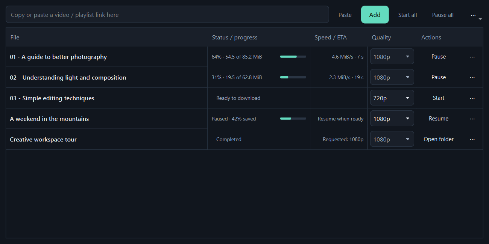

# Orvanta Video Downloader

Developed by [oOViperXOo](https://github.com/oOViperXOo).

Orvanta is the umbrella brand; this app is **Orvanta Video Downloader**. The text-free download/play icon remains the product icon. Existing settings, queue, history, browser pairing and single-instance activation retain their compatible internal identifiers. The new installer uses its own Orvanta folder and uninstall entry; an older installed version is preserved.

Download the latest Windows release from [GitHub Releases](https://github.com/oOViperXOo/video-downloader-desktop/releases/latest). The standalone Portable EXE is recommended; Setup also offers an installed mode.



*Actual app interface with illustrative queue entries.*

## Compact interface

Use **`dist\OrvantaVideoDownloader-Setup.exe`**. One setup offers two modes:

- **Portable EXE (recommended, selected by default):** setup extracts just `OrvantaVideoDownloader.exe`. Copy that EXE to another PC to run it. Runtime tools unpack temporarily at launch, so startup takes a few seconds. No shortcuts or Windows uninstall registration are added.
- **Install for this Windows user:** creates a Start menu shortcut and Windows uninstall entry. Its folder bundle starts faster; keep its EXE together with `_internal`. Uninstall preserves downloads and AppData.

Both formats use the current Windows user's existing AppData settings and history. Copying the portable EXE does not copy that data or browser login sessions. For an earlier portable-folder build, choose a new folder; its Data directory is preserved.

Select rows with Ctrl or Shift. Right-click for Open, Show in folder, Copy link, Open download page, Rename file, Move to, Delete file, Change URL, media copies and Remove from list. Actions depend on selection and file state. Delete file asks before permanently deleting from disk; Remove from list and the Delete key keep files. Change URL applies to one paused or failed item and starts with a fresh filename, preserving previous partial files. Double-click a completed row to open its file; missing files show a message. Make MP4 copy is offered for completed non-MP4 videos, and Make MP3 copy creates separate audio. Originals remain intact.


To prefix new playlist filenames automatically, open **Settings > Playlists**, enable **Automatically prefix new playlist filenames**, choose **01, 02…** or **001, 002…**, then save Settings once. Newly added playlists use the prefix automatically, for example `01 - Lesson title [video ID].mp4`. Existing queue items keep their filenames. Single videos are not numbered.

Paste a link in the compact top row and click **Add**, choose quality in the table, then Start or Start all. Active and completed records share one table. Each row's **···** button opens options when needed; Settings is in the main three-dot menu. The window starts at 960 × 520 and the columns fit when resized. See FEATURES-GUIDE.md for playlist folders, browser sign-in, scheduling and other options.

A native desktop app for Linux and Windows, built with PySide6, yt-dlp and FFmpeg. It downloads video and audio from YouTube and from the many other sites yt-dlp supports (Vimeo, Facebook, Instagram, TikTok, X/Twitter, Dailymotion, Twitch, Reddit, SoundCloud and more). Dark/light interface, playlist selection, a download queue, real resume of partial downloads and multi-connection downloading.

## Features

- **Real resume.** Partial `.part` files are always kept (pause, cancel, closing the app, crash, power loss). Starting the item again continues from the bytes already on disk (HTTP Range) instead of starting over. If a server does not support ranges, yt-dlp restarts that file safely.
- **Connection modes.** Single connection is the default for compatibility. Settings > *Connections and speed* also offers Multiple connections with 2-16 connections. Each queued item's options dialog can override its connection mode. Multiple mode uses aria2 for supported direct files and parallel fragments for HLS/DASH.
- **Parallel files.** Two files download at once by default; change the limit to 1-4 in Settings. Each file has its own progress and pause/resume controls.
- **Original format.** Video downloads preserve source codecs and automatically choose a compatible container. MP4 is an optional remux, without video re-encoding. Modern source codecs are preferred over forcing larger H.264 streams.
- **Many sites.** Any public `http(s)` link is accepted and yt-dlp decides whether it can handle it. Localhost, private/internal addresses, `file:` and other schemes and links with embedded passwords are blocked.
- **Login (optional).** Use cookies from your own browser for private or members-only videos you can already watch. Optional proxy.
- **Browser extension (optional).** The `browser-extension/` folder is a Chrome/Edge extension that sends the current page or a detected stream to the app on the same computer. See "Browser extension" below.

## Supported sites and limits

yt-dlp supports well over a thousand sites; the app does not keep a list of its own. The clipboard hint and notes know the common ones. Practical notes:

- **YouTube, SoundCloud, many others:** work without login (verified here: YouTube and SoundCloud).
- **Vimeo:** many videos work; some now answer "only works when logged-in" (seen during testing). Choose your browser under Settings > Login and network.
- **Instagram, Facebook, X/Twitter, TikTok:** often need a logged-in browser, may rate-limit, and change often. Update yt-dlp (rerun the launch script) when a site breaks. These sites were **not** tested against live content for this release.
- **DRM-protected video (Netflix, Disney+, most paid streaming, some live events) is not supported and is never bypassed.**
- Download only content you own or have the right to download, and respect each site's terms.

## Run from source

These development prerequisites are not needed for the portable EXE or optional installed version.

Install **Python 3.11 or newer (3.10 is the tested minimum)** and **FFmpeg (including ffprobe)**. Internet access is needed to install Python packages and load/download media.

### Windows

1. Install Python from https://www.python.org/downloads/windows/ (include the Python launcher).
2. In a terminal, install FFmpeg: `winget install --id Gyan.FFmpeg -e`. Alternatively install a trusted FFmpeg build and put its `bin` directory on PATH.
3. Reopen the terminal, extract this ZIP into a writable folder, then double-click `run.bat` or run `run.bat` from that folder.

### Linux

On Debian/Ubuntu: `sudo apt install python3 python3-venv ffmpeg libxcb-cursor0`.

Extract this ZIP and run this one command from its folder:

```sh
bash run.sh
```

The launch scripts create an isolated `.venv`, install/update the app's Python dependencies and launch the GUI. They do not silently install system packages or require administrator rights themselves. First launch takes longer. On subsequent launches, run the same command to update dependencies, or launch directly with `.venv/bin/python app.py` (Windows: `.venv\Scripts\python.exe app.py`).

## Use

1. Paste a video or playlist link from a supported site. The clipboard option suggests links from known sites locally; it never loads or downloads automatically.
2. Click **Add**. Items are inspected and queued without starting downloads. Private/deleted/unavailable entries can be missing or fail at download time.
3. Select quality in the table. Use the row's **···** button for Media, Save as and Connections; More options holds exact formats, Start all inclusion and optional MP4 copies.
4. Open **··· > Settings** for defaults, playlist folder/file naming, browser login, scheduling and simultaneous-file limits. Click **Apply**.
5. Click Start on an item or Start all. New items can be added during downloads.
6. Pause, retry or resume from the row action. Progress is per video/audio stream and can reset when the next stream starts. Errors show in the item detail.
7. Completed and archived records stay in the same table. Archived records have Open and single-record removal actions.

### Format and extra options

- MP4 video combines video and audio using FFmpeg. Best/worst and maximum heights from 144p to 2160p are available. A maximum height is a ceiling, not a promise that the site has that resolution. Resolution is prioritized over H.264 preference so 1440p/4K are not silently capped at 1080p. High-resolution MP4 may contain VP9 or AV1 video, which older players cannot decode; use a modern player such as VLC. MP4 is the container, not a promise of H.264.
- MP3 and M4A audio conversion uses FFmpeg. Audio bitrate is requested in kbps; source quality still limits the result.
- Subtitle downloads and MP4 embedding are optional. Default language expressions are `en.*,ar.*`; change them, for example to `en,ar`, or `all`. Auto-generated subtitles have a separate checkbox. Missing subtitles cannot be invented.
- Thumbnail embedding and metadata embedding are optional. This can require extra conversion and network requests. Availability and container support may vary.
- A speed limit such as `500K` or `2M` is **bytes per second**, not bits. Leave blank for unlimited.
- The filename template defaults to `%(title).150B [%(id)s].%(ext)s`. Keep `%(ext)s` so the extension matches the result. Templates use yt-dlp syntax. The output folder is the root; filename templates are intended to be filenames, not absolute paths.
- An archive-skipped item is labeled **skipped**, not **done**. If you deleted its media file and want to download again, remove the relevant `.completed-*.txt` file from the output folder or turn off skip-completed before adding it again.
- Completed-download archives are separated by output configuration so switching format/quality does not silently skip a different requested result. Turning off skip-existing does not overwrite existing media files.

### Pause, cancel and resume

Pause is **stop-and-resume**, not live process suspension. It stops yt-dlp and keeps partial files. Start / resume runs yt-dlp again with `--continue`, which reads the `.part` file and asks the server for the remaining bytes. The log shows "Continuing from N MiB" when that happens. Cancel also keeps partials; Clear finished removes rows, not files. **Pause all** stops the active item and holds the queued ones.

What resume can and cannot do (all verified with a local range server, see docs/reports/TEST_REPORT.md):

- After pause/cancel/close, or after killing the whole process (crash), the next run continues from the partial file.
- With **aria2c**, progress is saved to a `.aria2` control file every 5 seconds, so after a crash you can lose up to about 5 seconds of progress per file. A clean pause/stop saves immediately. Keep the `.aria2` file next to the `.part` file; deleting it makes aria2c start over.
- Servers that do not support Range requests, links that expire (many signed CDN URLs), and some postprocessing steps (merging, conversion) restart instead.
- Do not rename or delete `.part`, `.ytdl` or `.aria2` files if you want to resume. Changing format/quality for the same video starts a different download.

### Faster downloads (connections and aria2c)

Settings > *Speed and resume*:

- **Single connection** uses the native downloader with continuous progress and sequential writes. Use it when a site rejects parallel connections.
- **Multiple connections** uses the selected 2-16 connection count. It uses aria2c when available, otherwise native parallel fragments. The packaged Windows app includes aria2c. Multi-connection partial files can have a large logical length before those bytes finish transferring; progress uses transfer counters rather than file length.
- aria2 is GPLv2. The build scripts bundle it only if it is installed when you build; if you redistribute a build that contains it, include its license and source offer.
- The speed limit setting still applies.

### Login, cookies and proxy

*Settings > Login and network.* "Use cookies from browser" lets yt-dlp read your own browser login (Chrome, Firefox, Edge, Brave and others) for content your account can already watch. Cookies stay on your computer. On Windows, newer Chrome/Edge may refuse cookie access while the browser is open; close it or use Firefox. An optional proxy (`http://`, `https://`, `socks5://`) applies to loading and downloading.

### Browser extension

The `browser-extension/` folder is a Manifest V3 extension (Chrome/Edge; Firefox untested, see its README). It finds media on the page you are viewing and sends the link to the app on the same computer. It never starts a download by itself: the app fills the link box, loads the details and you choose what to queue.

1. In the app: Settings > *Browser extension* > make sure the option is on, **Save settings**, then **Pair browser** (shows a code valid 2 minutes).
2. Chrome/Edge: open `chrome://extensions`, enable Developer mode, **Load unpacked**, pick `browser-extension/`. Enter the code in the extension Options page.
3. Use the extension popup or right-click > *Download with app*.

Security: the receiver listens on `127.0.0.1:17653` only, accepts POSTs only from browser-extension origins with the right Host, needs a paired token (only its hash is stored), rate-limits requests, rejects private/internal targets and logs nothing. Cookies sent by the extension are optional, are written to a 0600 file (never onto a command line) and deleted when the download finishes. *Forget browsers* revokes all pairings; turn the option off to close the port. Known limit: a hostname can answer differently later (DNS rebinding); see `receiver.py`.

Downloads restored after an app restart are paused until you choose to resume. Settings and history live in your operating system's application-data directory. No private cookies, login capture or telemetry are built into this app.

Do not run multiple copies writing into the same state/output folder at once. File naming collisions are avoided by the video ID in the default template. Downloading the same video in multiple qualities to the same default filename can reuse an existing file; use separate output folders or a template that distinguishes variants when you want several copies.

## Build a single executable

Build **on the target OS**. PyInstaller does not cross-build Windows executables from Linux or vice versa.

- Windows: run `build.bat`. Output: `dist\OrvantaVideoDownloader.exe`.
- Linux: run `bash build.sh`. Output: `dist/VideoDownloaderDesktop`.

Launch scripts install yt-dlp default extras (including embedding helpers and YouTube challenge scripts) and a Deno JavaScript runtime in the virtual environment.

Both scripts also bundle aria2c if it is installed when you build (optional). Both scripts bundle the installed FFmpeg, ffprobe and virtual-environment Deno executables and collect yt-dlp's plugins/data. Python and PySide6 are packaged by PyInstaller. The Windows build opens without a console; worker processes use hidden output pipes. Read diagnostics in the app's Download messages tab. The build runs `tools/verify_build.py` to verify packaged GUI startup before reporting success.

A one-file build extracts its bundled tools to a temporary directory on each process launch. With bundled Deno/FFmpeg/Qt, this can take several seconds and uses substantial temporary disk space. Abrupt crashes can leave temporary extraction folders behind. For faster startup and fewer extractions, change `--onefile` to `--onedir` in the build script and distribute the complete output folder as a ZIP. Do not distribute only the executable from an onedir build. Linux executables still depend on compatible system libraries and a desktop display; build on the oldest Linux distribution you intend to support and test there. The scripts do not claim a universal portable binary. Consider FFmpeg build licensing and all dependency licenses before redistribution.

## Tests

```sh
python -m pip install pytest
QT_QPA_PLATFORM=offscreen python -m pytest -q      # aria2c tests run only if aria2c is on PATH
(cd browser-extension && node --test test/*.test.js)   # extension logic tests (Node 18+)
```

On Windows PowerShell, set `$env:QT_QPA_PLATFORM='offscreen'` before the pytest command.

See `docs/reports/TEST_REPORT.md` for historical verification details. Current packaged releases are in `dist/`; build scripts and source remain in the project root.

## Troubleshooting

- **FFmpeg missing:** install FFmpeg and ffprobe and reopen the app. Best video, merging, audio conversion and embedding need it.
- **Linux Qt xcb error:** install your distribution's Qt/xcb system dependencies (often `libxcb-cursor0`), or use a normal graphical desktop session.
- **A site says login required / unsupported / DRM:** see Supported sites and limits above. DRM is never bypassed.
- **aria2c not found message:** install aria2 or choose `off`; downloads still work.
- **Port 17653 busy:** another copy of the app is running; close it or turn off the browser option.
- **Site rejects a download (YouTube or other):** update yt-dlp by rerunning the launch script. YouTube changes frequently. A newer yt-dlp release may change its JavaScript-runtime or extra dependency requirements; Deno and current default extras are installed by the launcher. Consult its upstream instructions. The app does not bypass restrictions or guarantee every video will work.
- **Playlist load seems slow:** wait for metadata retrieval or close the app to stop it. Network failures and very large playlists can take time.
- **A download is stuck converting:** merging/conversion has no reliable network ETA. Give FFmpeg time, especially with large files; pausing during conversion may restart it.

## Rights and terms

Use only for personal downloading of content you own, have permission to save, or may otherwise lawfully download. Respect copyright and the service's terms. Many services' terms (YouTube's included) restrict downloading except where the service permits it. This app does not circumvent DRM, access controls or paid restrictions. It is not affiliated with YouTube or any other site, and the extension is not affiliated with any commercial download manager.

Upstream references:

- yt-dlp options and requirements: https://github.com/yt-dlp/yt-dlp
- YouTube terms: https://www.youtube.com/static?template=terms
- FFmpeg: https://ffmpeg.org/
- PySide6: https://doc.qt.io/qtforpython-6/
